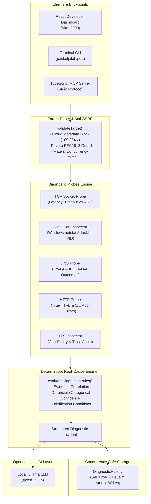

# 🧭 PacketPilot

> **Local-First Network Diagnostics & Root-Cause Troubleshooting Platform**

PacketPilot solves everyday local network and backend issues (like `ERR_CONNECTION_REFUSED`, port collisions, loopback binding mismatches, and DNS family quirks) through **deterministic evidence-based checks first**, augmented by optional local AI explanations via Ollama.

[](https://github.com/vivekyadav-3/packetpilot-/actions/workflows/ci.yml)
[](https://nodejs.org)
[](https://modelcontextprotocol.io)
[](https://opensource.org/licenses/MIT)

---

## 🏛️ System Architecture



---

## ✨ Key Engineering Highlights

### 1. Correlated Root-Cause Diagnoses (Not Fragmented Probe Dumps)
Instead of overwhelming developers with separate errors for `No process found` and `ECONNREFUSED`, PacketPilot correlates multiple observations into **one unified incident**:
- **Observed Facts:** Directly recorded by socket and OS table probes.
- **Inferred Cause:** Distinct from observed facts (e.g. *"Backend terminated unexpectedly"*).
- **Defensible Confidence:** Categorized strictly as `HIGH`, `MEDIUM`, or `LOW` with an explicit rationale (no synthetic percentage guesses).
- **Falsification Condition:** Documents exactly what measurement would disprove the diagnosis.

### 2. Multi-Layer Anti-SSRF & Target Policy
Every entrypoint (Express REST API, MCP tool handlers, and CLI) validates target hosts and URLs:
- **Cloud Metadata Protection:** Unconditionally blocks `169.254.169.254`, AWS IPv6 `fd00:ec2::254`, and `metadata.google.internal`.
- **Protocol Whitelist:** Restricts protocols strictly to `http:` and `https:` (rejects `file:`, `gopher:`, `ftp:`).
- **Sliding-Window Rate Limiter:** Protects local services against port scanning abuse (max 60 req/min/IP).
- **Concurrency Limiting:** Guards machine resources with a maximum of 10 concurrent diagnostic probe runs.

### 3. True TTFB & Granular Metrics
- Replaces naive response timers with Node streaming hooks that capture **True Time to First Byte (TTFB)** independently of total payload transfer time.
- Distinguishes network transport success from HTTP application failures (e.g. HTTP 500, 502, 504).
- Preserves individual IPv4 and IPv6 lookup outcomes in DNS probes, distinguishing `NODATA` (record absent) from `ETIMEOUT` or server failure.

### 4. Concurrency-Safe Atomic Persistence
- Employs a serialized asynchronous write queue and atomic file swaps (`.tmp` write followed by `fs.rename`) to ensure zero corrupted or overwritten records under concurrent diagnostic runs.

---

## 🖥️ Operating System Support Matrix

| Feature | Windows | Linux | macOS |
| :--- | :---: | :---: | :---: |
| **TCP Connectivity & Latency** | ✅ Supported | ✅ Supported | ✅ Supported |
| **DNS Dual-Stack (IPv4 / IPv6)** | ✅ Supported | ✅ Supported | ✅ Supported |
| **HTTP TTFB & Header Inspection** | ✅ Supported | ✅ Supported | ✅ Supported |
| **TLS Certificate Validation** | ✅ Supported | ✅ Supported | ✅ Supported |
| **Process Name & PID Detection** | ✅ Native (`netstat -ano` + `tasklist`) | ⏳ Roadmap (`/proc/net/tcp` & `ss`) | ⏳ Roadmap (`lsof -i`) |

> **Note on Process Detection:** Process detection is scoped strictly to local system sockets. For remote targets or unsupported environments, process inspection is safely skipped without claiming a negative result (*"missing evidence != negative evidence"*).

---

## 🚀 Quick Start

### 1. Installation
```powershell
# Clone the repository
git clone https://github.com/vivekyadav-3/packetpilot-.git
cd packetpilot-

# Install root dependencies
npm install

# Install dashboard dependencies
cd client
npm install
cd ..
```

---

### 2. Run via Terminal CLI
Diagnose any target host or port in seconds:
```powershell
# Check a closed or active port
npm start localhost 5000

# Explain findings using local Ollama (requires local Ollama running)
npm start localhost 5000 --ai
```

---

### 3. Run the Web Dashboard
Open two terminal windows:

**Terminal 1 (Backend API):**
```powershell
npm run server
```
*API runs at `http://localhost:4000`*

**Terminal 2 (React Dashboard):**
```powershell
cd client
npm run dev
```
*Dashboard opens at `http://localhost:3000`*

---

### 4. Run as an MCP Server
PacketPilot provides standard Model Context Protocol (MCP) tools over stdio for Claude, Antigravity, or Cursor:
```powershell
npm run mcp
```

#### Registered MCP Tools:
- `inspect_local_port`: Discovers owning process name, PID, and bind address.
- `check_tcp_port`: Tests TCP socket connectivity, measuring latency and separating refusal from timeouts.
- `resolve_dns`: Dual-stack IPv4/IPv6 resolution with individual query tracking.
- `check_http`: Measures True TTFB, response code, and application errors.
- `inspect_tls`: Inspects certificate validity, expiry days, and SANs.
- `run_full_diagnostic`: Correlates all probes and outputs structured root-cause findings.

---

## 🧪 Automated Test Suite (17 Tests)

PacketPilot features a **100% deterministic, offline test suite** that spins up ephemeral local `http.Server` and `net.Server` fixtures on port 0:

```powershell
npm test
```

### Verified Test Categories:
1. **Core Correlation Matrix:** Consistent, conflicting, and incomplete probe scenarios.
2. **Conflicting Evidence:** Detection of listening process with refused TCP connection (interface mismatch).
3. **True TTFB Measurement:** Artificially delayed header timing validation.
4. **Application Crash Categorization:** HTTP 500 server crash categorization.
5. **Anti-SSRF Security Policy:** Metadata IP blocking, RFC1918 modes, and invalid URL schemes.
6. **Rate Limiting & Concurrency:** Sliding window bursts and slot acquisition.
7. **Storage Concurrency:** 10 simultaneous writes verified with 0 lost records.

---

## ⚠️ Known Limitations
1. **Local Host Boundary:** Process detection (PID / executable name) operates only on the local machine where PacketPilot is executed. Remote servers can only be diagnosed through network-level probes.
2. **Ollama Optionality:** The natural-language explanation layer depends on a running local Ollama daemon (`ollama serve`). If Ollama is offline, PacketPilot functions completely without degradation using its deterministic rules.
